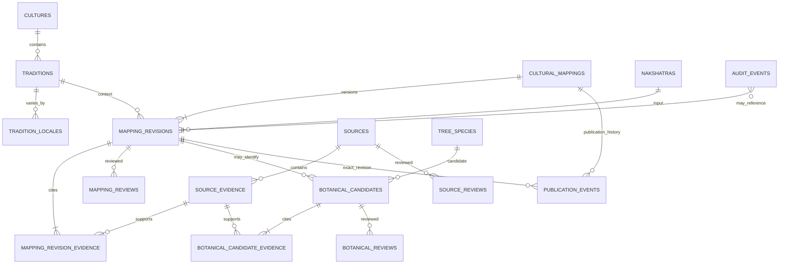

# Phase 1 registry and workflow

## Entity relationships

## Workflow invariants

- Mapping revisions are immutable rows with a stable `(mapping_id, version)` pair. A new claim, condition, evidence set, or candidate set is a new revision.
- Review history and publication history are append-only. Both reference the exact revision UUID.
- Publication requires the latest review for that revision to be approved by a cultural or regional-language reviewer, at least one linked source evidence record, a verified source, and documented permitted/citation-only rights. Evidence text is returned only when rights permit it.
- A later revision does not change the content of the currently published revision. A publication event switches the active revision; unpublish and withdrawal events retain all history.
- Botanical candidates and botanical review are independent from cultural review. No candidate is definitive unless exactly one non-rejected candidate remains, its certainty is `confirmed`, and a botanical reviewer approves it.
- Synthetic records in automated tests are isolated to a dedicated test database. The shipped database has no cultural mapping seed.

## Migration inventory

- `0001_registry.sql`: relational catalog, sources/evidence, mapping revisions/reviews, botanical candidates/reviews, publication and audit events, immutable revision trigger, published view.
- `0002_nakshatra_reference.sql`: the 27 accepted canonical Nakshatra input values only.
- `0003_workflow_guards.sql`: source review records, append-only workflow triggers, publication rights and evidence gate.
- `0004_nakshatra_tradition_catalog.sql`: initial tradition and locale selectors, no mapping claims.
- `0005_latest_decision_gate.sql`: prevents publication if the latest decision on the exact revision is not approval.
- `0006_publication_integrity.sql`: restricts publication to the newest revision, requires every linked cultural evidence item to be verified and rights-cleared, and ensures unpublish/withdraw targets the current revision.
- `0007_botanical_evidence_gate.sql`: requires verified, rights-cleared evidence before a botanical candidate can be approved.
- `0008_review_publication_consistency.sql`: blocks re-reviewing an actively published revision; changes require a new revision or explicit publication withdrawal.
- `0009_registry_immutability.sql`: makes evidence passages and botanical candidates immutable, prevents referenced species/source metadata edits, requires source status changes to follow review history, and requires every candidate to have evidence.
